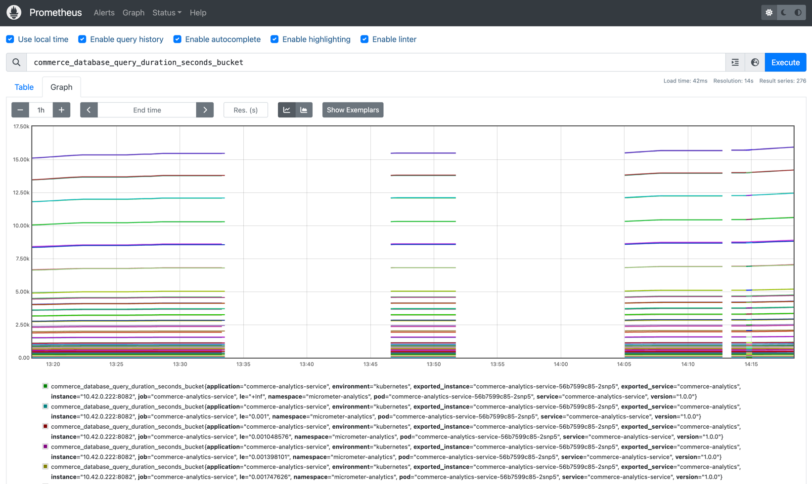
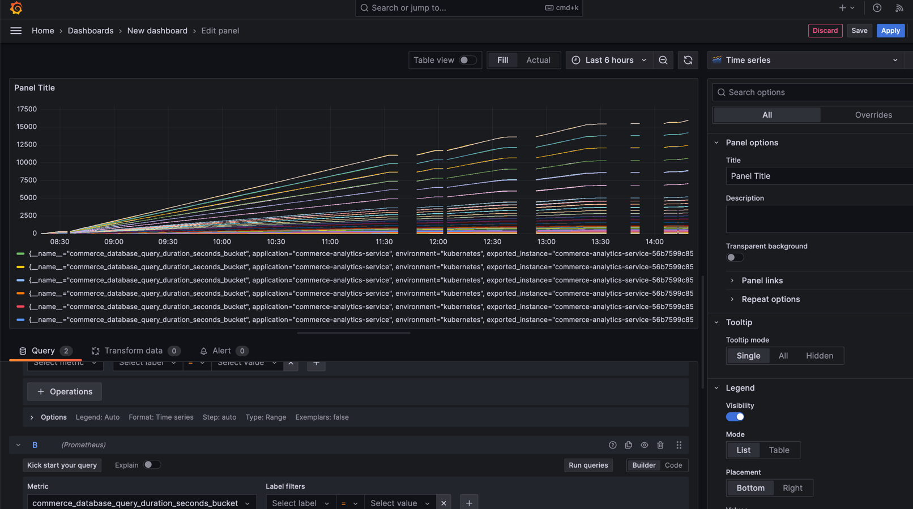

# Micrometer Services - Multi-Service Analytics Platform

A Maven-based multi-service Spring Boot platform demonstrating comprehensive Micrometer metrics integration with Prometheus for observability and monitoring.

## Architecture

This project consists of two specialized microservices with a complete monitoring stack:

1. **User Analytics Service** (Port 8081) - Focuses on user-related metrics
2. **Commerce Analytics Service** (Port 8082) - Focuses on commerce and transaction metrics
3. **Prometheus** (Port 9090) - Metrics collection and storage
4. **Grafana** (Port 3000) - Metrics visualization and dashboards

With both UI exposed for Prometheus and Grafana



## Project Structure

```
micrometer_generator/
├── pom.xml                           # Root Maven POM (multi-module)
├── prometheus.yml                    # Prometheus scraping configuration
├── docker-compose.yml               # Full stack Docker Compose
├── build.sh                         # Build all services
├── run-local.sh                     # Run services locally with Maven
├── run-docker.sh                    # Run services with Docker Compose
├── run-individual.sh                # Run individual services
├── docker-build.sh                  # Build Docker images
│
├── user-analytics-service/
│   ├── pom.xml
│   ├── Dockerfile
│   └── src/main/java/com/example/useranalytics/
│       ├── UserAnalyticsApplication.java
│       ├── controller/UserController.java
│       ├── service/UserMetricsService.java
│       ├── service/UserSimulationService.java
│       └── config/UserMetricsConfiguration.java
│
└── commerce-analytics-service/
    ├── pom.xml
    ├── Dockerfile
    └── src/main/java/com/example/commerceanalytics/
        ├── CommerceAnalyticsApplication.java
        ├── controller/CommerceController.java
        ├── service/CommerceMetricsService.java
        ├── service/CommerceSimulationService.java
        └── config/CommerceMetricsConfiguration.java
```

## Overview

This platform generates distinct sets of metrics from two specialized services to simulate a real-world microservices environment:

### User Analytics Service Metrics
- **User Counters**: Registrations, logins, sessions, engagement events
- **User Gauges**: Active users, online users, session duration, cache size
- **User Timers**: Request durations, authentication times, profile load times
- **User Distribution Summaries**: Session durations, activity scores

### Commerce Analytics Service Metrics
- **Commerce Counters**: Orders, payments, product views, cart actions
- **Commerce Gauges**: Inventory levels, active orders, total revenue, database connections
- **Commerce Timers**: Order processing, payment processing, inventory checks
- **Commerce Distribution Summaries**: Order values, shipping costs, product ratings

## Requirements

- **Java**: OpenJDK 21 (Amazon Corretto 23 JDK configured in JAVA_HOME)
- **Build Tool**: Maven 3.6+
- **Docker**: For containerized deployment (optional)
- **Docker Compose**: For full stack deployment (optional)

## Quick Start

### 1. Build All Services
```bash
./build.sh
```

### 2. Run Services Locally
```bash
./run-local.sh
```

### 3. Run with Docker Compose (includes Prometheus + Grafana)
```bash
./run-docker.sh

# Access services:
# - User Analytics: http://localhost:8081
# - Commerce Analytics: http://localhost:8082
# - Prometheus: http://localhost:9090
# - Grafana: http://localhost:3000 (admin/admin123)
```

## Service Details

### User Analytics Service (Port 8081)

**Endpoints:**
- `GET /api/users` - Get users list
- `POST /api/users` - Create new user (triggers registration metrics)
- `GET /api/users/profile` - Get user profile
- `POST /api/users/auth` - Authenticate user
- `POST /api/users/sessions` - Create user session
- `GET /api/health-check` - Service health check
- `POST /api/simulate/{type}` - Manual metric simulation

**Key Metrics:**
- `user.registrations.total` - User registrations with source/type tags
- `user.logins.total` - User logins with auth method tags
- `user.sessions.total` - User sessions
- `user.active.count` - Currently active users gauge
- `user.request.duration` - User request processing times

### Commerce Analytics Service (Port 8082)

**Endpoints:**
- `GET /api/orders` - Get orders list
- `POST /api/orders` - Create new order
- `GET /api/products` - Get products catalog
- `POST /api/payments` - Process payment (10% failure rate)
- `GET /api/cart` - Get shopping cart
- `POST /api/cart` - Update shopping cart
- `GET /api/health-check` - Service health check
- `POST /api/simulate/{type}` - Manual metric simulation

**Key Metrics:**
- `commerce.orders.total` - Orders with type/payment method tags
- `commerce.payments.total` - Payments with method/currency/status tags
- `commerce.products.views.total` - Product views with category tags
- `commerce.inventory.levels` - Current inventory levels gauge
- `commerce.revenue.total` - Total revenue gauge
- `commerce.order.processing.duration` - Order processing times

## Building and Running

### Build Options

```bash
# Build all services
./build.sh

# Build individual service
mvn -f user-analytics-service/pom.xml clean package
mvn -f commerce-analytics-service/pom.xml clean package

# Build with tests
mvn clean package
```

### Running Options

#### Option 1: Local Development (Maven)
```bash
# Run both services
./run-local.sh

# Run individual service
./run-individual.sh user-analytics
./run-individual.sh commerce-analytics
```

#### Option 2: Docker Containers
```bash
# Build Docker images
./docker-build.sh

# Run with Docker Compose (includes Prometheus)
./run-docker.sh

# Run individual containers
docker run -p 8081:8081 user-analytics-service:latest
docker run -p 8082:8082 commerce-analytics-service:latest
```

## Prometheus Integration

### Accessing Metrics

Prometheus metrics are available at:
- User Analytics: `http://localhost:8081/actuator/prometheus`
- Commerce Analytics: `http://localhost:8082/actuator/prometheus`

### Prometheus Configuration

The included `prometheus.yml` configures scraping for both services:

```yaml
scrape_configs:
  - job_name: 'user-analytics-service'
    static_configs:
      - targets: ['localhost:8081']
    scrape_interval: 5s
    metrics_path: /actuator/prometheus

  - job_name: 'commerce-analytics-service'
    static_configs:
      - targets: ['localhost:8082']
    scrape_interval: 5s
    metrics_path: /actuator/prometheus
```

### Running Prometheus Standalone

```bash
# Using Docker
docker run -d \
  --name prometheus \
  -p 9090:9090 \
  -v $(pwd)/prometheus.yml:/etc/prometheus/prometheus.yml \
  prom/prometheus
```

Access Prometheus UI at: `http://localhost:9090`

## Grafana Integration

### Accessing Grafana

Grafana is automatically configured with Prometheus as a data source and includes pre-built dashboards.

**Access:** `http://localhost:3000`
**Default Credentials:**
- Username: `admin`
- Password: `admin123`

### Pre-configured Dashboards

The project includes a comprehensive "Analytics Platform Overview" dashboard that displays:

- **Request Rate by Service**: Shows HTTP request rates for both services
- **User Activity Rate**: User registrations and login metrics
- **Commerce Activity Rate**: Order and payment processing rates
- **Active Users Gauge**: Real-time active user count
- **User Request Duration**: 95th and 50th percentile request processing times
- **Order Processing Duration**: Commerce service processing time metrics

### Running Grafana

#### Option 1: Docker Compose (Recommended)
```bash
# Run complete stack including Grafana
./docker-build.sh && ./run-docker.sh

# Access Grafana at: http://localhost:3000
# Username: admin, Password: admin123
```

#### Option 2: Standalone Grafana with Docker
```bash
# Run Prometheus first
docker run -d --name prometheus -p 9090:9090 \
  -v $(pwd)/prometheus.yml:/etc/prometheus/prometheus.yml prom/prometheus

# Run Grafana with Prometheus connection
docker run -d --name grafana -p 3000:3000 \
  -e GF_SECURITY_ADMIN_USER=admin \
  -e GF_SECURITY_ADMIN_PASSWORD=admin123 \
  grafana/grafana:10.2.0
```

#### Option 3: Kubernetes Deployment
```bash
# Deploy to Kubernetes (includes Grafana)
cd k8s
kubectl apply -k .

# Wait for pods to be ready
kubectl wait --for=condition=ready pod -l app.kubernetes.io/name=grafana -n micrometer-analytics --timeout=120s

# Access Grafana via NodePort (optimized for local access)
open http://localhost:30300

# Or use the access checker script
./check-grafana-access.sh

# Alternative: port-forwarding
kubectl port-forward -n micrometer-analytics svc/grafana 3000:3000
```

### Custom Dashboard Creation

To create custom dashboards:

1. **Access Grafana**: Navigate to `http://localhost:3000`
2. **Login**: Use admin/admin123
3. **Create Dashboard**: Click "+" > "Dashboard"
4. **Add Panel**: Click "Add panel"
5. **Configure Query**: Use Prometheus queries (see examples below)
6. **Save Dashboard**: Click save icon and provide name

### Grafana Configuration

The Grafana instance is pre-configured with:
- **Prometheus Data Source**: `http://prometheus:9090`
- **Dashboard Provisioning**: Automatic dashboard loading
- **Authentication**: Admin user with password
- **Plugins**: Pie chart panel plugin

### Troubleshooting Grafana

1. **Connection Issues:**
   ```bash
   # Check if Grafana can reach Prometheus
   docker exec grafana wget -qO- http://prometheus:9090/api/v1/targets
   ```

2. **Dashboard Not Loading:**
   ```bash
   # Check dashboard files exist
   ls -la grafana/dashboard-files/
   
   # Restart Grafana container
   docker restart grafana
   ```

3. **Authentication Problems:**
   ```bash
   # Reset admin password (Docker Compose)
   docker exec -it grafana grafana-cli admin reset-admin-password newpassword
   ```

4. **NodePort Access Issues (Kubernetes):**
   ```bash
   # Use the access checker script for comprehensive diagnostics
   ./check-grafana-access.sh
   
   # Manual troubleshooting
   kubectl get svc grafana-nodeport -n micrometer-analytics
   kubectl get pods -n micrometer-analytics -l app.kubernetes.io/name=grafana
   kubectl logs -n micrometer-analytics -l app.kubernetes.io/name=grafana
   ```

## Example Prometheus Queries

### User Analytics Service Queries

```promql
# User registration rate
rate(user_registrations_total[1m])

# User login success rate
rate(user_logins_total{success="true"}[1m]) / rate(user_logins_total[1m])

# Average session duration
rate(user_session_duration_sum[1m]) / rate(user_session_duration_count[1m])

# Active users by region
sum by (region) (rate(user_requests_by_region_total[1m]))

# 95th percentile authentication time
user_auth_duration{quantile="0.95"}
```

### Commerce Analytics Service Queries

```promql
# Order rate by payment method
sum by (payment_method) (rate(commerce_orders_total[1m]))

# Revenue rate (dollars per second)
rate(commerce_revenue_total[1m]) / 100

# Payment failure rate
rate(commerce_payments_total{status="failed"}[1m]) / rate(commerce_payments_total[1m])

# Average order value
rate(commerce_order_value_sum[1m]) / rate(commerce_order_value_count[1m])

# 99th percentile order processing time
commerce_order_processing_duration{quantile="0.99"}

# Product views by category
sum by (category) (rate(commerce_products_views_total[1m]))
```

### Cross-Service Queries

```promql
# Total requests across both services
sum(rate(http_server_requests_total[1m]))

# Service comparison - request rates
sum by (service) (rate(http_server_requests_total[1m]))

# Memory usage across services
sum by (service) (jvm_memory_used_bytes{area="heap"})
```

## Configuration

### Application Properties

The application can be configured via `src/main/resources/application.yml`:

```yaml
app:
  metrics:
    simulation:
      enabled: true              # Enable/disable background simulation
      interval-seconds: 5        # User activity simulation interval
      users:
        min: 10                  # Minimum active users
        max: 100                 # Maximum active users
      orders:
        min: 1                   # Minimum orders per simulation
        max: 50                  # Maximum orders per simulation
```

### Environment Variables

- `SPRING_PROFILES_ACTIVE` - Set active Spring profiles
- `SERVER_PORT` - Override server port (default: 8080)
- `APP_METRICS_SIMULATION_ENABLED` - Enable/disable background simulation

## Metric Tags and Labels

All metrics include common tags:
- `application` - Application name
- `environment` - Environment (development, staging, production)
- `version` - Application version
- `instance` - Instance identifier

Additional metric-specific tags:
- **Error metrics**: `error_type`, `status_code`
- **Order metrics**: `order_type`, `payment_method`
- **User registration**: `source`, `user_type`
- **Regional metrics**: `region`
- **Endpoint metrics**: `endpoint`

## Development

### Disable Background Simulation

To disable background metric generation during development:

```yaml
app:
  metrics:
    simulation:
      enabled: false
```

Or set environment variable:
```bash
export APP_METRICS_SIMULATION_ENABLED=false
```

### Custom Metrics

To add custom metrics, inject the `MeterRegistry` and create your metrics:

```java
@Service
public class MyService {
    private final Counter myCounter;
    
    public MyService(MeterRegistry meterRegistry) {
        this.myCounter = Counter.builder("my.custom.metric")
            .description("My custom counter")
            .tag("service", "my-service")
            .register(meterRegistry);
    }
}
```

## Monitoring Stack Integration

This application is designed to work well with:

- **Prometheus** - Metrics collection and storage
- **Grafana** - Visualization and dashboards
- **AlertManager** - Alerting based on metrics
- **Jaeger/Zipkin** - Distributed tracing (can be added)

## Docker Containerization

### Docker Images

This project includes Dockerfiles for both services that:

- Use Eclipse Temurin JRE 21 Alpine image for small size
- Run applications with a non-root user for security
- Include health checks to verify service readiness
- Configure optimized JVM settings for containerized environments

### Docker Compose Setup

The included `docker-compose.yml` configures a complete stack:

- User Analytics Service on port 8081
- Commerce Analytics Service on port 8082
- Prometheus on port 9090 (with configured scraping)
- Grafana on port 3000 (with pre-configured dashboards)

### Building and Running

```bash
# Build Docker images
./docker-build.sh

# Run full stack
./run-docker.sh
```

## Running Prometheus with Services

### Option 1: Full Stack with Docker Compose (Recommended)

This is the easiest way to run the complete monitoring stack:

```bash
# Build and run everything (services + Prometheus)
./docker-build.sh && ./run-docker.sh

# Access services:
# - User Analytics: http://localhost:8081
# - Commerce Analytics: http://localhost:8082
# - Prometheus UI: http://localhost:9090
```

### Option 2: Local Services + Dockerized Prometheus

Run Spring services locally with Maven and Prometheus in Docker:

```bash
# 1. Start both Spring services locally
./run-local.sh

# 2. Run Prometheus in Docker (configured for localhost services)
docker run -d \
  --name prometheus \
  -p 9090:9090 \
  -v $(pwd)/prometheus.yml:/etc/prometheus/prometheus.yml \
  prom/prometheus

# 3. Verify services are accessible
curl http://localhost:8081/actuator/health
curl http://localhost:8082/actuator/health

# 4. Access Prometheus UI
open http://localhost:9090
```

### Option 3: Native Prometheus Installation

If you have Prometheus installed locally:

```bash
# 1. Start both Spring services
./run-local.sh

# 2. Start Prometheus with our config
prometheus --config.file=./prometheus.yml --storage.tsdb.path=./prometheus-data

# 3. Access Prometheus UI
open http://localhost:9090
```

## Testing the Setup

### Comprehensive Health Check

Use the provided test script to verify everything is working:

```bash
# Make script executable and run
chmod +x test-metrics.sh
./test-metrics.sh
```

### Manual Verification Steps

1. **Check Service Health:**
   ```bash
   curl http://localhost:8081/actuator/health
   curl http://localhost:8082/actuator/health
   ```

2. **Verify Metrics Endpoints:**
   ```bash
   # Check User Analytics metrics
   curl http://localhost:8081/actuator/prometheus | grep "user_"
   
   # Check Commerce Analytics metrics
   curl http://localhost:8082/actuator/prometheus | grep "commerce_"
   ```

3. **Test Prometheus Scraping:**
   ```bash
   # Check Prometheus targets status
   curl http://localhost:9090/api/v1/targets
   
   # Query sample metrics
   curl "http://localhost:9090/api/v1/query?query=user_engagement_total"
   curl "http://localhost:9090/api/v1/query?query=commerce_revenue_total"
   ```

4. **Generate Test Data:**
   ```bash
   # Trigger metric generation
   curl -X POST http://localhost:8081/api/simulate/all
   curl -X POST http://localhost:8082/api/simulate/all
   ```

### Prometheus Web UI

Once Prometheus is running, access the web interface at `http://localhost:9090`:

- **Status > Targets**: View scraping target health
- **Graph**: Execute PromQL queries
- **Status > Configuration**: View current Prometheus config

## Kubernetes Deployment

### Quick Kubernetes Setup

```bash
# Deploy to Kubernetes (includes building Docker images)
cd k8s
./scripts/deploy-all.sh

# Test the deployment
./scripts/test-deployment.sh

# Access services via NodePort
open http://localhost:30090  # Prometheus
open http://localhost:30300  # Grafana (admin/admin123)

# Or use port-forwarding
kubectl port-forward -n micrometer-analytics svc/prometheus 9090:9090
kubectl port-forward -n micrometer-analytics svc/grafana 3000:3000
```

### Kubernetes Cleanup

```bash
# Complete uninstall (Kubernetes + Docker images)
cd k8s
./scripts/complete-uninstall.sh

# Kubernetes-only cleanup (keep Docker images)
./scripts/cleanup.sh

# Docker images only
./scripts/purge-docker-images.sh
```

See the [Kubernetes README](k8s/README.md) for detailed deployment instructions, replica set configuration, and troubleshooting.

## Docker Troubleshooting

### Common Issues

1. **Port Conflicts:**
   ```bash
   # Check what's using the ports
   lsof -i :8081 :8082 :9090
   
   # Stop conflicting containers
   docker stop $(docker ps -q)
   ```

2. **Docker Network Issues:**
   ```bash
   # For macOS Docker Desktop, services should use host.docker.internal
   # This is already configured in prometheus.yml
   
   # Test connectivity from Prometheus container
   docker exec prometheus wget -qO- http://host.docker.internal:8081/actuator/health
   ```

3. **Volume Mount Issues:**
   ```bash
   # Ensure prometheus.yml exists and is readable
   ls -la prometheus.yml
   
   # Check Docker volume mount
   docker inspect prometheus | grep -A5 -B5 "prometheus.yml"
   ```

### Clean Reset

To completely reset the Docker environment:

```bash
# Stop all containers
docker stop $(docker ps -aq) 2>/dev/null || true

# Remove containers
docker rm $(docker ps -aq) 2>/dev/null || true

# Remove images (optional)
docker rmi user-analytics-service commerce-analytics-service 2>/dev/null || true

# Rebuild and restart
./docker-build.sh && ./run-docker.sh
```

## Troubleshooting

### Service Health Checks

Verify service health status:
```bash
# User Analytics Service
curl http://localhost:8081/actuator/health

# Commerce Analytics Service
curl http://localhost:8082/actuator/health
```

### Metrics Verification

Check metrics endpoints:
```bash
# View available User Analytics metrics
curl http://localhost:8081/actuator/metrics | grep user

# View available Commerce Analytics metrics
curl http://localhost:8082/actuator/metrics | grep commerce

# View Prometheus format metrics
curl http://localhost:8081/actuator/prometheus
curl http://localhost:8082/actuator/prometheus
```

### Manually Generate Metrics

Trigger metric generation manually:
```bash
# Generate all User Analytics metrics
curl -X POST http://localhost:8081/api/simulate/all

# Generate specific Commerce Analytics metrics
curl -X POST http://localhost:8082/api/simulate/orders
curl -X POST http://localhost:8082/api/simulate/payments
```

### Port Conflicts

If you encounter port conflicts:

1. Check for processes using ports 8081 and 8082:
   ```
   lsof -i :8081
   lsof -i :8082
   ```

2. Update application.yml files to use different ports, or use environment variables:
   ```
   SERVER_PORT=8083 ./run-individual.sh user-analytics
   ```
